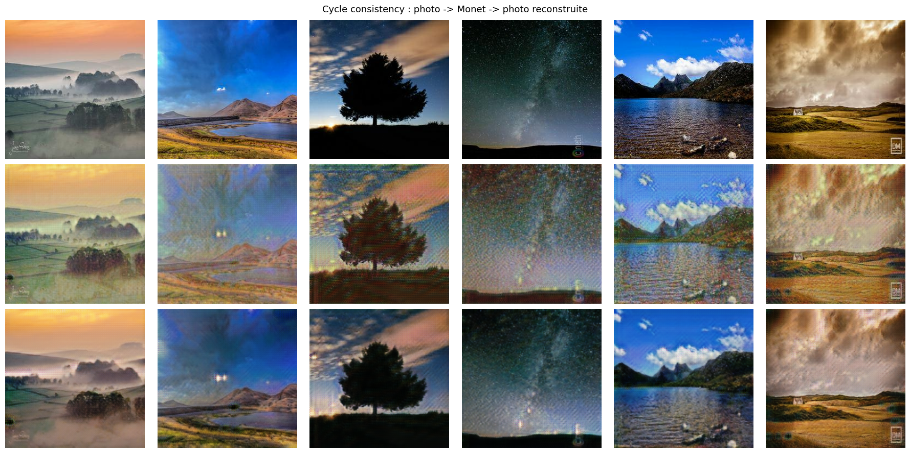
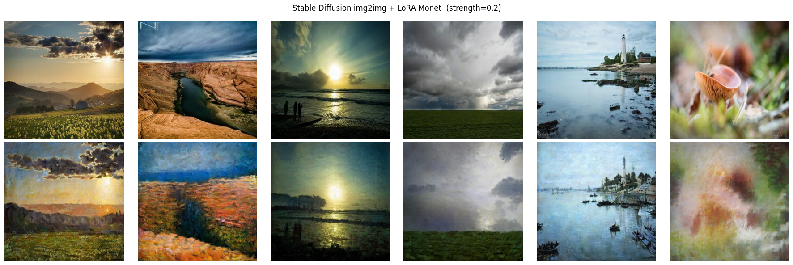

# Monet Style Transfer

**Turn photographs into Monet-inspired paintings using two different generative approaches.**

This project implements a CycleGAN for unpaired image translation and explores
Stable Diffusion image-to-image generation with an existing Monet LoRA adapter.

**Python · PyTorch · torchvision · Diffusers · Jupyter**

## Original visual results



The rows show the input photographs, photo-to-Monet translations and reconstructed
photographs after the reverse mapping.



The figures were extracted unchanged from the original notebook, including French
labels. They were not regenerated for this repository. A third retained figure shows
the [original CycleGAN training curves](docs/images/cyclegan-training.png).

## Two approaches

| | CycleGAN | Stable Diffusion + LoRA |
|---|---|---|
| Main idea | Learn photo ↔ painting mappings from unpaired images | Apply a pretrained generative model and style adapter |
| Architecture | Two residual generators and two PatchGAN discriminators | Stable Diffusion 1.5 image-to-image pipeline |
| Objective / controls | Least-squares GAN, cycle-consistency and identity losses | Prompt, denoising strength and guidance scale |
| Project work | Model implementation and training workflow | Inference experiments with an existing adapter |

The LoRA is **J-YOON/lora-monet-sd1.5**; this project does not claim to have trained it.
The notebook uses the prompt `msl monet`, strength 0.20, guidance 7.0 and 100 inference
steps for the recorded diffusion comparison.

## Explore the notebook

Open [monet_style_transfer.ipynb](monet_style_transfer.ipynb). It contains the data
pipeline, generator/discriminator definitions, losses, optional training loop,
image export and diffusion example. Installation logs, assignment questions and
thousands of generated submission images are omitted.

For local use, create a Python 3.11 or 3.12 environment and install:

```bash
python -m pip install -r requirements.txt
python -m jupyterlab
```

Download the [Kaggle Monet/photo dataset](https://www.kaggle.com/competitions/gan-getting-started/data)
and place `monet_jpg/` and `photo_jpg/` inside `data/gan-getting-started/`. The first
code cell exposes `BASE_INPUT`, `OUTPUT_ROOT` and `WEIGHTS_PATH`; change them for
Kaggle or another local directory. Use a CUDA-capable GPU for the original workflow.

The original CycleGAN checkpoint is **not included** in the available source folder.
If you have it, set `WEIGHTS_PATH` to it. Training is disabled by default; set
`TRAIN_FROM_SCRATCH = True` deliberately to train without a checkpoint. Bulk image
export is also disabled by default. The README figures can be viewed without running
any model. Stable Diffusion and the adapter download separately from Hugging Face.

## Experimental limits

- The retained images are qualitative examples, not a matched quantitative comparison.
- No verified FID/miFID result is included.
- Original outputs do not constitute a complete execution trace of the cleaned notebook.
- CycleGAN uses all Monet images for training and a 75/25 split of the sorted photograph list; this is not a general-purpose benchmark protocol.
- Identity/content can change during stylization. Diffusion and CycleGAN use different resolutions and assumptions.

## References

- [CycleGAN project, Zhu et al.](https://junyanz.github.io/CycleGAN/).
- [Kaggle: I'm Something of a Painter Myself](https://www.kaggle.com/competitions/gan-getting-started).
- [J-YOON Monet LoRA model card](https://huggingface.co/J-YOON/lora-monet-sd1.5).
- [Stable Diffusion 1.5 model](https://huggingface.co/runwayml/stable-diffusion-v1-5).

Dataset and external models retain their own terms.
